<div align="center">


<br />

<a href="https://atmos-zeta-ten.vercel.app"></a>
<a href="https://github.com/Crusty-chirayu/Atmos"></a>
<a href="docs/"></a>

<br /><br />

**An AI-powered weather intelligence platform: explore a real 3D Earth, ask questions in plain language or by voice, and get answers grounded in live data for exactly the place you’re looking at.**

</div>

<br />


Most weather apps end at the forecast card. ATMOS starts there. It is one connected system where **geographic interaction, weather retrieval and conversation share a single live context**: pick a point on the globe, and the dashboard, the radar map and the assistant all update to that place.

It is not a weather-API wrapper with a chat window bolted on. It is a full-stack product with accounts, saved places, alerts, push notifications, an installable PWA and a deliberately restrained, premium interface.

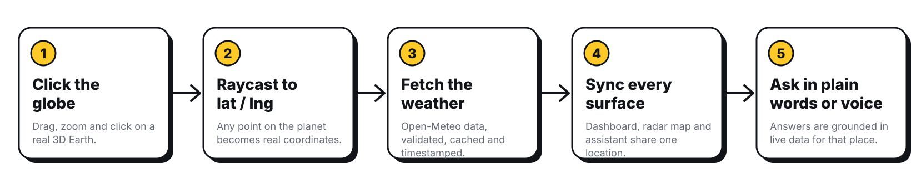

<br />


<table>
<tr>
<td width="50%" valign="top">
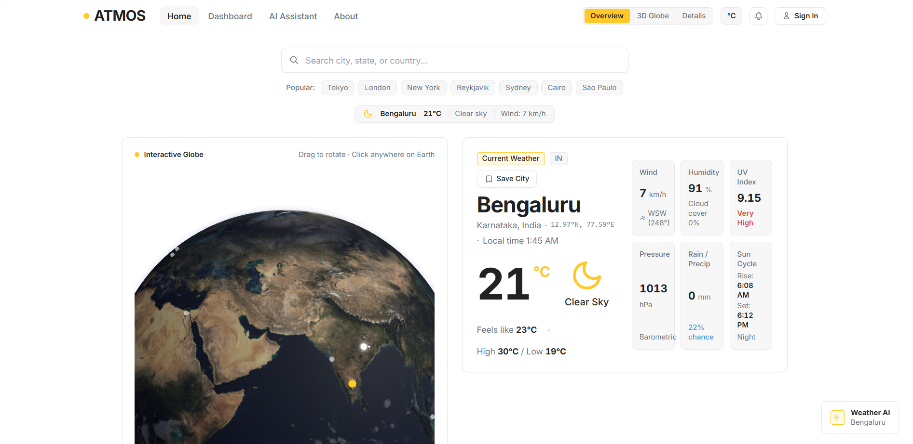
<br /><sub><b>Overview.</b> Globe, current conditions, search and quick picks on one screen.</sub>
</td>
<td width="50%" valign="top">
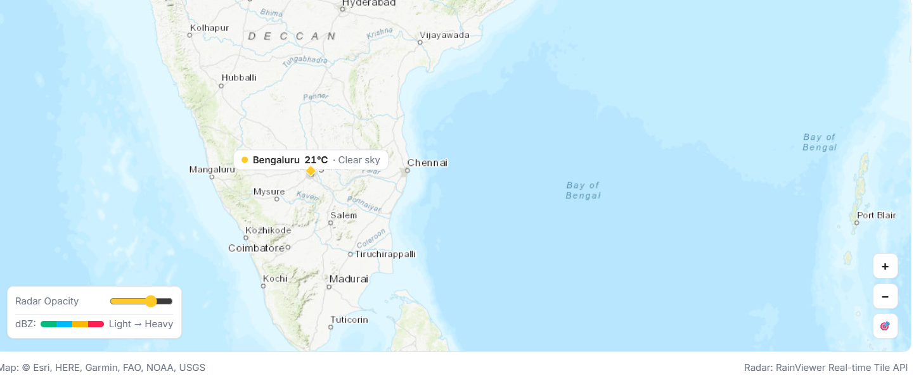
<br /><sub><b>Radar map.</b> Live RainViewer precipitation overlay with an opacity control.</sub>
</td>
</tr>
<tr>
<td width="50%" valign="top">
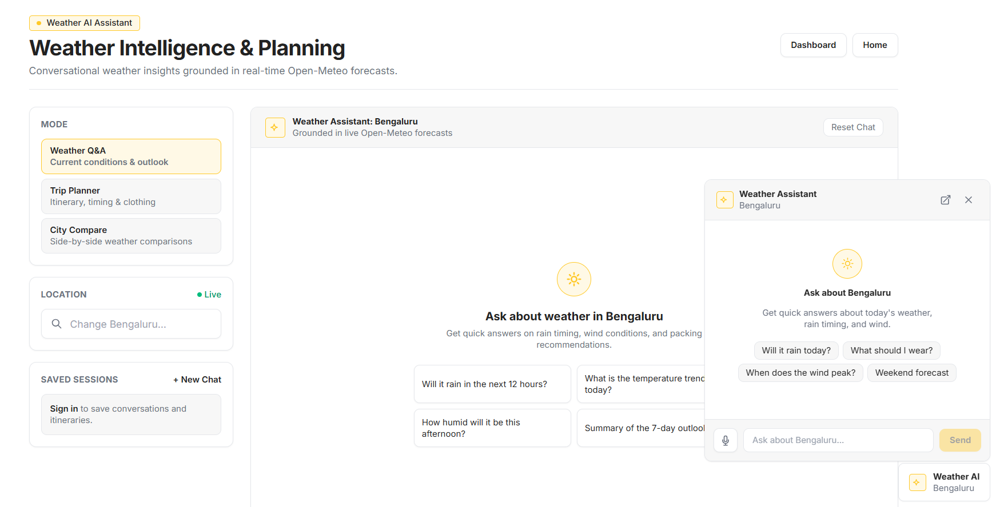
<br /><sub><b>AI workspace.</b> Weather Q&amp;A, trip planner and city compare, tied to the selected place.</sub>
</td>
<td width="50%" valign="top">
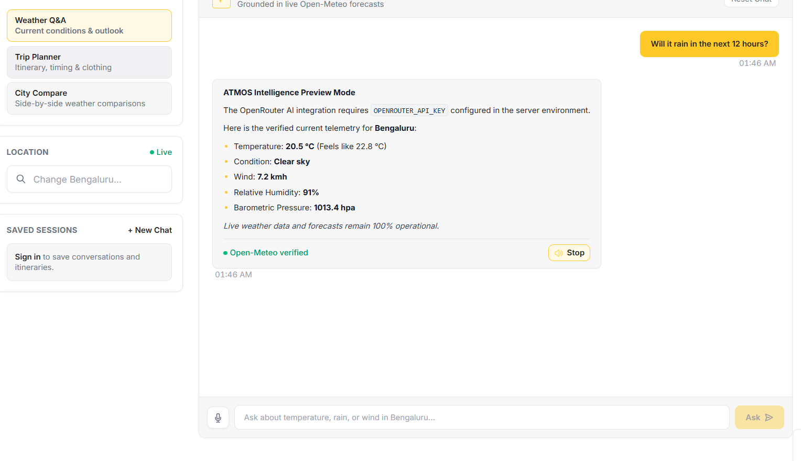
<br /><sub><b>Grounded answers.</b> Replies list the verified Open-Meteo telemetry they are based on. Voice input sits next to the text box.</sub>
</td>
</tr>
</table>

<br />


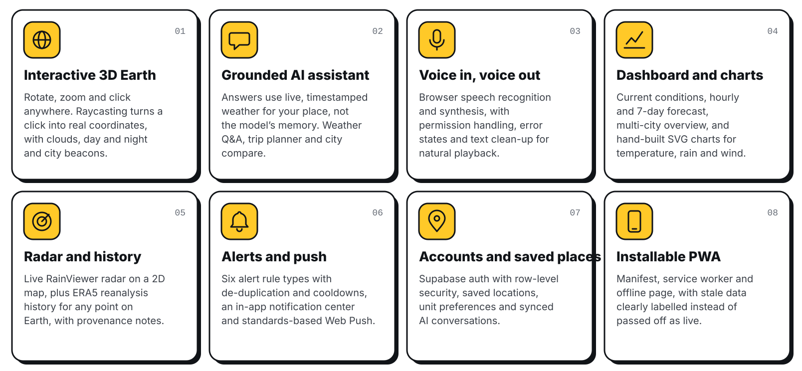

> **Runs without an AI key.** If no model key is configured, the assistant falls back to a preview mode that still answers from the same verified live weather data. Weather itself never depends on the language model.

<br />


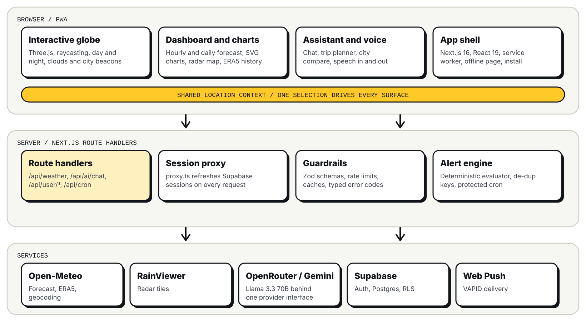

### Engineering decisions that matter

- **The model never invents the weather.** The assistant is handed a timestamped, structured snapshot fetched server-side. If data is missing, it says so. Open-Meteo stays the source of truth; the model explains and plans.
- **Providers sit behind adapters.** Weather, geocoding and AI each have a typed interface. OpenRouter (Llama 3.3 70B by default, override with `OPENROUTER_MODEL`) is the default AI provider, and a Gemini adapter plugs into the same registry.
- **Missing is not zero.** Domain models use nullable fields, canonical units are converted at the edge, and stale or cached data is labelled instead of passed off as live.
- **Alerts are deterministic.** A pure evaluator checks six rule types (high or low temperature, high wind, precipitation, freeze, severe weather), with hourly de-duplication keys and cooldowns so a storm does not spam you. A protected cron endpoint drives it.
- **Secrets stay server-side.** Row-level security guards user data, the service-role key and AI keys never reach the browser, and the app ships strict security headers (HSTS, frame denial, content-type and referrer policies).
- **Validated at every boundary.** Zod schemas guard route inputs; geocoding and AI routes are rate-limited.

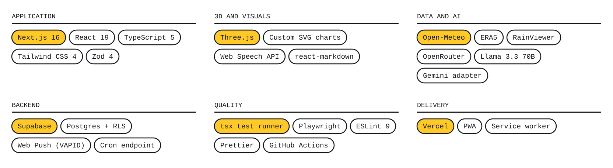

<br />


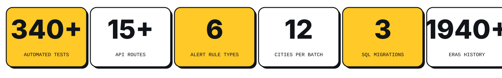

<sub>Counted from the repository: test cases across unit and integration suites, route handlers under <code>src/app/api</code>, and the migrations in <code>supabase/</code>. Developer-reported results, not a third-party audit.</sub>

<br />


**Prerequisites:** Node.js 20+, npm, and a Supabase project if you want accounts, saved places and alerts.

```bash
git clone https://github.com/Crusty-chirayu/Atmos.git
cd Atmos
npm install
cp .env.example .env.local   # then fill in the values below
npm run dev                  # http://localhost:3000
```

**Database:** apply the three SQL files in [`supabase/migrations`](supabase/migrations) in order (Supabase SQL editor or the Supabase CLI).

### Environment

| Variable | Scope | Purpose |
|---|---|---|
| `NEXT_PUBLIC_APP_URL` | public | Base URL for metadata, redirects and auth callbacks |
| `NEXT_PUBLIC_SUPABASE_URL` | public | Supabase project URL |
| `NEXT_PUBLIC_SUPABASE_ANON_KEY` | public | Browser key, governed by row-level security |
| `SUPABASE_SERVICE_ROLE_KEY` | **server only** | Account deletion and cron work |
| `OPENROUTER_API_KEY` | **server only** | AI assistant (preview mode without it) |
| `OPENROUTER_MODEL` | server | Optional model override |
| `GEMINI_API_KEY` | **server only** | Optional Gemini fallback |
| `NEXT_PUBLIC_VAPID_PUBLIC_KEY`, `VAPID_PRIVATE_KEY`, `VAPID_SUBJECT` | public / **server only** | Web Push (generate with `npx web-push generate-vapid-keys`) |
| `CRON_SECRET` | **server only** | Protects `/api/cron/evaluate-alerts` |
| `OPEN_METEO_BASE_URL`, `MAPBOX_ACCESS_TOKEN` | optional | Custom weather endpoint, optional map token |

Open-Meteo needs no API key for non-commercial use. See [`docs/ENVIRONMENT.md`](docs/ENVIRONMENT.md) for details.

### Scripts

| Command | What it does |
|---|---|
| `npm run dev` | Dev server with Turbopack |
| `npm run build` / `npm start` | Production build and server |
| `npm run lint` / `npm run typecheck` | ESLint and TypeScript checks |
| `npm test` | Unit and integration tests (`tsx --test`) |
| `npm run format` / `format:check` | Prettier |

### Scheduled alerts

Call `/api/cron/evaluate-alerts` from any scheduler (for example Vercel Cron or GitHub Actions) with the header `Authorization: Bearer <CRON_SECRET>`. Evaluation is idempotent and de-duplicated, so retries are safe.

<br />


- **CI on every push and pull request:** format check, ESLint, type-check, tests and a production build (GitHub Actions, Node 20).
- **Never commit `.env.local`.** Rotate any credential that is ever exposed, and keep production variables separate in your host.
- **Honest about dependencies.** Forecasts depend on Open-Meteo, AI replies on the configured provider and its quota, auth on your Supabase project, and voice on browser support for the Web Speech API. Push delivery needs VAPID configuration and is best-effort; in-app notifications stay the durable record.
- ERA5 history is reanalysis data, not station observations, and the app labels it that way.

<details>
<summary><b>Project docs</b></summary>

<br />

[Architecture](ARCHITECTURE.md) · [Data](DATA.md) · [AI](AI.md) · [UI/UX](UI_UX.md) · [Security](SECURITY.md) · [Testing](TEST.md) · [Deployment](DEPLOYMENT.md) · [Decisions](DECISIONS.md) · [Plan](PLAN.md) · [All feature docs](docs/)

</details>

### Roadmap

- [ ] More weather visualization layers
- [ ] More granular, configurable alerts
- [ ] Deeper AI conversations and trip planning
- [ ] Improved mobile interaction
- [ ] Additional weather data sources

### Contributing

Fork, branch (`git checkout -b feature/your-feature`), run `npm run lint && npm run typecheck && npm test`, then open a pull request with a clear description.

### License

[MIT](LICENSE)

<br />

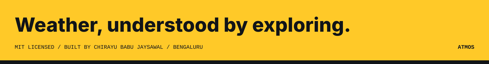