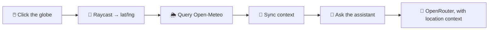
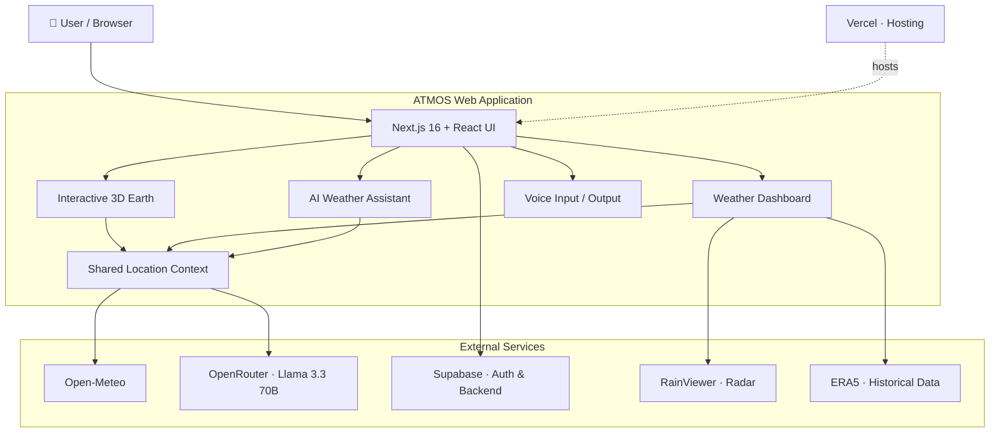

<div align="center">

# 🌍 ATMOS

### Weather, understood by exploring — not just reading.

An AI-powered weather intelligence platform where you explore a real 3D Earth,
ask questions in plain language or by voice, and get answers grounded in
exactly the place you're looking at.

<br>

[](https://atmos-zeta-ten.vercel.app)
[](https://github.com/Crusty-chirayu/Atmos)

<br>


</div>

<br>

## Overview

Most weather apps end at the forecast card. ATMOS starts there.

It's a full-stack platform that fuses live weather data, a Three.js-rendered 3D Earth you can rotate and click anywhere on, a conversational AI assistant that knows what location you're looking at, and voice input/output — all sharing one live context. Pick a point on the globe, and the dashboard, the forecast, and the AI assistant all update to match it.

ATMOS isn't a weather-API wrapper with a chat window bolted on. It's one connected system: **geographic interaction → weather retrieval → contextual conversation**, built as a real full-stack product with authentication, personalization, and a deliberately restrained, premium interface — clean whites and neutrals with a signature yellow accent, not another dark-glassmorphism dashboard clone.

<br>

## Visual Preview

<!--
  Replace this section with genuine screenshots once available. Suggested captures:
    1. docs/screenshots/dashboard.png   — Main ATMOS weather dashboard
    2. docs/screenshots/globe.png       — Interactive 3D Earth globe mid-interaction
    3. docs/screenshots/assistant.png   — AI assistant conversation panel
    4. docs/screenshots/voice.png       — Voice input/output in action
  Keep this HTML table structure — it renders as a clean 2x2 image grid on GitHub.
-->

## ATMOS — Inside the Experience

<table>
<tr>
<td width="50%" align="center">
<strong>Weather Dashboard</strong><br><br>

</td>
<td width="50%" align="center">
<strong>Interactive 3D Earth</strong><br><br>

</td>
</tr>
<tr>
<td width="50%" align="center">
<strong>AI Weather Assistant</strong><br><br>

</td>
<td width="50%" align="center">
<strong>Voice Interaction</strong><br><br>

</td>
</tr>
</table>


## What Makes ATMOS Different

Weather apps and AI chatbots both exist. What's less common is the connective tissue between them — the part where clicking a point on a spinning globe actually *means something* to the rest of the app a moment later.

| | |
|---|---|
| 🌐 **Coordinates, not city lists** | The globe isn't a decoration with a dropdown underneath. Raycasting against the Earth sphere turns any point you click into real latitude/longitude — you're not limited to a preset list of cities. |
| 🔗 **One shared context, three surfaces** | The dashboard, the globe, and the AI assistant all read from the same selected-location state. Change it in one place, and the others follow. |
| 🗣️ **An assistant that knows where you are** | The AI isn't answering in a vacuum — it's handed the current location context, so "what should I pack?" means something concrete instead of nothing at all. |
| 🎙️ **Hands-free by design** | Speech recognition in, speech synthesis out — voice isn't a bolt-on accessibility checkbox, it's a first-class way to use the app. |

<br>

## Feature Showcase

### ☀️ Real-Time Weather
Live conditions and forecasts sourced from **Open-Meteo**, presented through a centralized dashboard built to work in lockstep with the rest of the app rather than as an isolated screen. Accuracy, refresh cadence, and data availability are governed by the upstream provider.

### 🌐 Interactive 3D Earth
A real-texture globe rendered with **Three.js** and **React Three Fiber**. Interaction is resolved through raycasting against the sphere — pointer position becomes geographic coordinates, which become a weather query. It's a genuine geographic exploration surface, not a satellite feed or a simulation engine.

### 🤖 AI Weather Assistant
A conversational layer running on **`meta-llama/llama-3.3-70b-instruct`** via **OpenRouter**. It handles natural-language weather questions, destination queries, general knowledge, follow-ups, and intent routing — all informed by the same location context shared across the app. The AI reasons and converses; Open-Meteo remains the source of truth for the weather itself.

### 🎙️ Voice In, 🔊 Voice Out
Browser-native speech recognition and synthesis, with permission handling, error states, voice selection favoring natural-sounding voices where available, and text normalization for cleaner playback. Behavior varies by browser and OS, as it does for any Web Speech API implementation.

### 🔐 Accounts & 📍 Saved Locations
**Supabase** powers authentication and backend services. Signed-in users can save locations they return to often, feeding straight back into the shared location context used by the dashboard, globe, and assistant.

### 🌧️ Radar & History
**RainViewer** contributes precipitation/radar visualization, and **ERA5** contributes historical and reanalysis weather data — additional lenses on top of the live forecast.

### 🔔 Weather Alerts
Alert functionality is built into the platform to help surface relevant conditions. Actual delivery channels (e.g. browser push) depend on deployment-specific configuration such as VAPID keys, and aren't guaranteed across every environment.

<br>

## How ATMOS Works

The core loop connecting geography, weather, and conversation:



1. **Select a location** — through the dashboard search or by clicking directly on the 3D globe.
2. **Resolve coordinates** — Three.js raycasting converts the globe interaction into real geographic coordinates.
3. **Retrieve weather** — those coordinates drive a live query against Open-Meteo.
4. **Synchronize context** — the selection propagates to the dashboard and the AI assistant, so everything reflects the same place.
5. **Ask, contextually** — the assistant answers using that shared location, rather than treating every message as a cold, contextless prompt.

This is what makes the globe more than a visual flourish: it's a genuine input device for the rest of the application, and it's the reason clicking a spot and then asking "what should I wear tomorrow?" actually works the way you'd expect.

<br>

## Architecture

<sub>Conceptual system overview — not a generated dependency graph.</sub>



<br>

## Technology Stack

<table>
<tr><th>Layer</th><th>Technology</th><th>Role</th></tr>
<tr><td>Framework</td><td><strong>Next.js 16</strong></td><td>Application framework, full-stack architecture</td></tr>
<tr><td>Language</td><td><strong>TypeScript</strong></td><td>Type-safe application code</td></tr>
<tr><td>UI</td><td><strong>React</strong></td><td>Component-based interface</td></tr>
<tr><td>Auth & Backend</td><td><strong>Supabase</strong></td><td>Authentication and backend infrastructure</td></tr>
<tr><td>AI Gateway</td><td><strong>OpenRouter</strong></td><td>AI model access and routing</td></tr>
<tr><td>AI Model</td><td><strong>Llama 3.3 70B Instruct</strong></td><td>Conversational assistant</td></tr>
<tr><td>Weather Data</td><td><strong>Open-Meteo</strong></td><td>Live conditions and forecasts</td></tr>
<tr><td>3D Rendering</td><td><strong>Three.js</strong></td><td>Interactive Earth visualization</td></tr>
<tr><td>3D + React</td><td><strong>React Three Fiber</strong></td><td>React bindings for the globe</td></tr>
<tr><td>Animation</td><td><strong>GSAP</strong></td><td>Interface motion and interaction polish</td></tr>
<tr><td>Radar</td><td><strong>RainViewer</strong></td><td>Precipitation visualization</td></tr>
<tr><td>Historical Data</td><td><strong>ERA5</strong></td><td>Reanalysis / historical weather data</td></tr>
<tr><td>Hosting</td><td><strong>Vercel</strong></td><td>Deployment and hosting</td></tr>
</table>

<br>

## Getting Started

### Prerequisites

- Node.js compatible with Next.js 16
- npm, or the package manager matching the repo's committed lockfile
- A Supabase project (auth + backend)
- An OpenRouter API key
- Access to the relevant weather data services

### Clone & install

```bash
git clone https://github.com/Crusty-chirayu/Atmos.git
cd Atmos
npm install
```

### Configure environment

Create a local env file based on the project's `.env.example` (if present) and its actual configuration — the exact variable names haven't been independently verified here, so confirm against the repo itself. Known configuration categories:

| Variable category | Purpose |
|---|---|
| Supabase project URL | Connects the app to Supabase |
| Supabase publishable / anon key | Client-side Supabase access |
| Supabase service-role key *(if used)* | Privileged server-side operations — **server-side only, never public** |
| OpenRouter API key | Server-side AI access — **never exposed client-side** |
| Application URL *(if required)* | Deployment/app URL config |
| VAPID / push config *(if required)* | Browser push notifications |

### Run locally

```bash
npm run dev
```

Conventionally available at `http://localhost:3000` — confirm the exact command and port against `package.json`.

### Production build

```bash
npm run build
npm run start
```

<br>

## Testing & Validation

<div align="center">

| Check | Reported Result |
|---|---|
| Vitest unit tests | ✅ 343 passed |
| Test suites | 98 reported |
| TypeScript type checking | ✅ Passed |
| Lint | ✅ Passed |
| Production build | ✅ Passed |

</div>

At the latest reported development milestone, the project's local workflow recorded 343 passing Vitest tests across 98 reported suites, with type checking, linting, and the production build all reported as passing. These are developer-reported results from the local workflow — not an independent third-party audit, security review, or performance benchmark.

<br>

## Security & Configuration

- Never commit `.env.local` or any file containing secrets.
- Never expose the Supabase **service-role** key to the browser.
- Keep the **OpenRouter API key** strictly server-side.
- Configure production environment variables separately in Vercel — don't reuse local `.env` values as-is.
- Rotate any credential that's ever accidentally exposed.
- Apply Supabase's recommended row-level security and access-control practices to user data.

<br>

<details>
<summary><strong>Third-Party Dependencies & Limitations</strong></summary>
<br>

ATMOS is intentionally built on top of several external services, which means its runtime behavior is tied to theirs:

- **Weather data** depends on Open-Meteo's availability and accuracy.
- **AI responses** depend on OpenRouter and the configured model's availability, quotas, and billing status.
- **Auth/backend** depends on the configured Supabase project and its service limits.
- **Voice features** depend on the user's browser and OS supporting the Web Speech API, plus granted permissions.
- **Globe rendering** depends on the client device's graphics capability.
- **Push notifications** may require additional deployment-specific configuration and aren't guaranteed across every environment.

These are normal operational dependencies of the architecture — not confirmed active incidents.

</details>

<br>

## Future Possibilities

- [ ] Additional weather visualization layers
- [ ] More configurable, granular weather alerts
- [ ] Deeper AI conversation capabilities
- [ ] Expanded personalization and saved-location features
- [ ] Improved mobile and responsive interaction
- [ ] Additional weather data source integrations
- [ ] Expanded developer documentation and onboarding
- [ ] Broader automated test coverage

<br>

## Contributing

1. Fork the repository
2. Create a feature branch — `git checkout -b feature/your-feature`
3. Make and test your changes
4. Open a pull request with a clear description

<br>

## License

Check the repository's `LICENSE` file for the applicable licensing terms.

<br>

<div align="center">

## Author

**Chirayu Babu Jaysawal**

[](https://github.com/Crusty-chirayu)

<sub>Built at the intersection of full-stack engineering, interactive 3D graphics, and applied AI.</sub>

</div>
