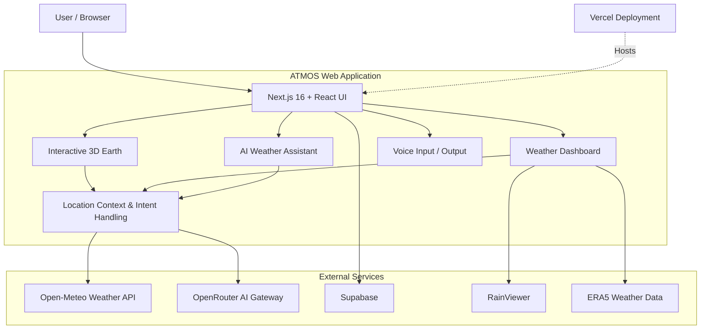

# 🌍 ATMOS

### AI-Powered Weather Intelligence Platform

*Real-time forecasts. Interactive 3D Earth exploration. Conversational, voice-enabled AI — in one modern web application.*

[](https://atmos-zeta-ten.vercel.app)
[](https://github.com/Crusty-chirayu/Atmos)
[](https://nextjs.org/)
[](https://www.typescriptlang.org/)
[](https://supabase.com/)

**[🌐 Live App](https://atmos-zeta-ten.vercel.app)** · **[📦 Source Code](https://github.com/Crusty-chirayu/Atmos)** · **[👤 Author](https://github.com/Crusty-chirayu)**

---

## Overview

ATMOS is a full-stack weather intelligence platform that goes beyond the traditional dashboard-and-forecast-card model. It brings together **real-time weather data**, an **interactive 3D Earth globe**, a **context-aware AI assistant**, **voice interaction**, and **personalized locations** into a single, unified experience.

Instead of forcing users to bounce between a weather app, a maps app, and a search engine to answer questions like *"what's the weather like where I'm traveling?"*, ATMOS lets them explore the planet on a real 3D globe, ask a question in plain language or by voice, and get an answer that's aware of exactly where they are looking.

> ATMOS is an AI-powered weather intelligence platform that combines real-time weather forecasts, interactive 3D Earth exploration, personalized weather insights, and conversational voice-enabled AI in one modern web application.

It is not a static weather widget, not a bare API wrapper, and not "just a chatbot" — it's a full-stack product with a real UI, backend services, external data integrations, and AI-driven interaction layered on top.

---

## The Problem

Conventional weather apps are good at showing numbers on a dashboard, but they fall short the moment a question gets contextual:

- *What's the weather like in a city I've never been to?*
- *What happens if I just pick a random point on the map?*
- *What should I expect at my travel destination next week?*
- *Can I just ask instead of digging through five screens?*
- *Can I talk to it instead of typing?*
- *Can it remember the places I care about?*

ATMOS was built to answer all of these inside one connected experience — without giving up the clarity of a proper weather app.

---

## Key Features

| | Feature | Summary |
|---|---|---|
| ☀️ | **Real-Time Weather** | Live conditions and forecasts powered by Open-Meteo |
| 📊 | **Weather Dashboard** | Clean, unified view synced with the globe and AI assistant |
| 🌐 | **Interactive 3D Earth** | A real-texture globe you can rotate and click to pick any coordinate on the planet |
| 🤖 | **AI Weather Assistant** | Natural-language, context-aware assistant via OpenRouter (Llama 3.3 70B) |
| 🎙️ | **Voice Input** | Ask questions out loud using browser speech recognition |
| 🔊 | **AI Voice Output** | Assistant responses read back via browser speech synthesis |
| 🔐 | **Accounts & Auth** | Supabase-powered authentication and personalized sessions |
| 📍 | **Saved Locations** | Quick access to the places that matter to you |
| 🔔 | **Weather Alerts** | Notification functionality to help you stay ahead of conditions |

---

## Screenshots

> 📸 *Screenshots coming soon.* This section is a placeholder — drop real UI captures here (dashboard, globe interaction, AI assistant panel) once available.

```
docs/
└── screenshots/
    ├── dashboard.png
    ├── globe.png
    └── assistant.png
```

---

## Technology Stack

| Category | Technology | Purpose |
|---|---|---|
| Frontend framework | **Next.js 16** | Main web application framework |
| Language | **TypeScript** | Typed application development |
| UI | **React** | Component-based interface |
| Application layer | **Next.js full-stack architecture** | App logic and server-side functionality |
| Auth & backend | **Supabase** | Authentication and backend infrastructure |
| AI gateway | **OpenRouter** | AI model access and integration |
| AI model | **Meta Llama 3.3 70B Instruct** | Conversational model powering the assistant |
| Weather data | **Open-Meteo** | Live weather and forecast data |
| 3D visualization | **Three.js** | Interactive 3D Earth rendering |
| 3D + React | **React Three Fiber** | React bindings for the Three.js globe |
| Animation | **GSAP** | Interactive animation and motion |
| Radar | **RainViewer** | Precipitation and radar visualization |
| Historical data | **ERA5** | Historical / reanalysis weather data |
| Hosting | **Vercel** | Deployment and hosting |

---

## Architecture

The diagram below is a **high-level conceptual overview** — not a verified source-code dependency graph.



---

## How ATMOS Works

ATMOS ties geographic exploration, weather retrieval, and conversational AI into a single connected loop:

1. **Location selection** — the user picks a location via the dashboard or by interacting directly with the 3D globe.
2. **Coordinate resolution** — globe clicks are translated into real geographic coordinates using **Three.js raycasting** against the Earth sphere, so any point on the planet is selectable, not just a fixed list of cities.
3. **Weather retrieval** — the resolved coordinates are used to fetch live conditions from **Open-Meteo**.
4. **Interface sync** — the selected location propagates across the dashboard, globe, and AI assistant, so the whole app stays contextually aligned.
5. **Contextual AI assistance** — when a user asks a question, the assistant uses that shared location context (via **OpenRouter**) to give a relevant, grounded answer rather than treating the conversation as generic chat.

This is an integrated full-stack web application with external service integrations — not a distributed microservices system.

---

## Feature Deep Dive

### 🌐 Interactive 3D Earth Globe
Built with Three.js and React Three Fiber, the globe renders a real Earth texture and supports raycasting-based coordinate selection — click anywhere on the planet and get weather for that exact point. It is a geographic and weather exploration interface, not a satellite-tracking or live-imagery service.

### 🤖 AI Weather Assistant
Powered by `meta-llama/llama-3.3-70b-instruct` through OpenRouter. It handles natural-language weather questions, destination queries, general knowledge, follow-ups, and intent routing — using a dynamic location-context provider shared with the dashboard and globe.

**Flow:** `User question → Intent & context handling → OpenRouter (Llama 3.3 70B) → Generated response → UI`

The AI layer handles conversation and context; actual weather data always comes from Open-Meteo.

### 🎙️ Voice Input & 🔊 Voice Output
Speech recognition and speech synthesis run entirely in-browser, with permission and error handling built in. Voice selection favors natural-sounding voices where the browser provides them. Availability and quality depend on the user's browser, OS, and permissions.

### 🔐 Accounts & Personalization
Supabase handles authentication and backend infrastructure. Saved locations let users keep frequently checked places close at hand, feeding into the same shared location context used by the dashboard, globe, and assistant.

### 🔔 Alerts
Weather-alert functionality is part of the broader feature set, intended to help users stay informed of relevant conditions. Delivery channels and thresholds depend on deployment-specific configuration.

---

## Getting Started

### Prerequisites

- Node.js (a version compatible with Next.js 16)
- npm (or the package manager matching the repo's lockfile — pnpm/yarn also supported if that's what's committed)
- A Supabase project (auth + backend)
- An OpenRouter API key (AI functionality)
- Access to the relevant weather data services

### Clone the repository

```bash
git clone https://github.com/Crusty-chirayu/Atmos.git
cd Atmos
```

### Install dependencies

```bash
npm install
```

> Use the package manager that matches the repo's committed lockfile.

### Configure environment variables

Create a local env file based on the project's `.env.example` (if present) and the app's actual configuration. **Never guess or hardcode secrets.**

| Configuration | Purpose |
|---|---|
| Supabase project URL | Connects the app to Supabase |
| Supabase publishable / anon key | Client-side Supabase integration |
| Supabase service-role key *(if required)* | Privileged server-side operations — **server-side only** |
| OpenRouter API key | Server-side AI model access |
| Application URL *(if required)* | Deployment/app URL configuration |
| VAPID / notification config *(if required)* | Browser push notifications |

### Run the dev server

```bash
npm run dev
```

App will typically be available at `http://localhost:3000` — confirm the exact command/port against `package.json`.

### Production build

```bash
npm run build
npm run start
```

---

## Security & Configuration

- Never commit `.env.local` or any file containing secrets.
- Never expose the Supabase **service-role** key to the browser.
- Keep the OpenRouter API key server-side only.
- Use scoped public credentials only where the service explicitly supports it.
- Configure production environment variables separately in Vercel.
- Rotate any credential that is ever accidentally exposed.
- Follow Supabase's recommended access controls and row-level security practices.

Weather and AI functionality depend on third-party provider availability, quotas, and rate limits — plan accordingly.

---

## Deployment & Validation

ATMOS is deployed on **Vercel**:

🔗 **[atmos-zeta-ten.vercel.app](https://atmos-zeta-ten.vercel.app)**

At the latest reported development milestone, the following were shipped:

- AI location-context integration
- Globe ↔ dashboard synchronization
- Arbitrary coordinate-based weather selection
- AI intent routing and contextual handling
- OpenRouter integration
- Markdown rendering for AI responses
- Browser speech recognition & synthesis, with permission/error handling
- UI and globe interaction refinements

The development workflow reported the following results:

| Validation | Reported Result |
|---|---|
| Vitest unit tests | 343 passed |
| Test suites | 98 |
| TypeScript type checking | Passed |
| Lint | Passed |
| Production build | Passed |

These are developer-reported results from the local workflow, not an independent third-party audit.

---

## Known Limitations & Dependencies

ATMOS relies on several external services, so its behavior is naturally tied to their availability:

- Weather data depends on the Open-Meteo upstream provider.
- AI responses depend on OpenRouter and the configured model's availability, quotas, and billing.
- Supabase features depend on the configured project's limits and settings.
- Voice features depend on browser speech-API support and user-granted permissions.
- Globe rendering depends on the client device's graphics capability.
- Notification features may require additional production-specific configuration.

These are normal operational dependencies of the architecture, not confirmed active issues.

---

## Engineering Highlights

ATMOS was built as a full-stack software engineering project spanning several disciplines:

- **Full-stack development** — Next.js + TypeScript with backend services, auth, external APIs, and production deployment.
- **AI integration** — conversational AI via OpenRouter with real application context, not an isolated chatbot.
- **Geographic computing** — mapping 3D pointer interaction to real-world coordinates via raycasting.
- **Interactive visualization** — Three.js + React Three Fiber for a genuinely explorable Earth.
- **Browser APIs** — native speech recognition and synthesis for voice-driven UX.
- **Service integration** — weather, AI, auth, and hosting infrastructure working as one system.
- **Production discipline** — concept → implementation → testing → iteration → deployment.

---

## Future Improvements

Potential directions — not yet implemented:

- [ ] Additional weather visualization options
- [ ] More configurable weather alerts
- [ ] Deeper AI weather conversation capabilities
- [ ] Expanded personalization & saved-location features
- [ ] Improved mobile/responsive interactions
- [ ] Additional weather data source integrations
- [ ] Expanded documentation & developer onboarding
- [ ] More automated, production-grade testing

---

## Contributing

Contributions are welcome:

1. Fork the repository
2. Create a feature branch (`git checkout -b feature/your-feature`)
3. Make and test your changes
4. Open a pull request with a clear description

---

## License

Check the repository for its `LICENSE` file to determine the applicable licensing terms.

---

## Author

**Chirayu Babu Jaysawal**

- GitHub: [@Crusty-chirayu](https://github.com/Crusty-chirayu)

---

<p align="center">Built with ☕, curiosity, and a genuine interest in weather + AI.</p>
