# ATMOS — Gemini AI Platform Specification & Architecture

## Milestone 6 (M6) Technical Documentation

---

## 1. Executive Summary

ATMOS Milestone 6 introduces an enterprise-grade, meteorologically-grounded generative AI platform powered by Google AI's Gemini 2.0 models (`gemini-2.0-flash`). Unlike conventional ungrounded chatbots that hallucinate numerical weather readings, ATMOS couples real-time Open-Meteo telemetry with multi-turn conversational intelligence, anti-hallucination system instructions, voice synthesis and transcription, and user-isolated Supabase persistence.

### Key Architectural Pillars
1. **Server-Side Provider Abstraction**: Dedicated `AIProvider` contract with zero client-side credential exposure.
2. **Deterministic Meteorological Grounding**: Before any prompt reaches Gemini, ATMOS synthesizes a validated `WeatherGroundingSnapshot` from real-time Open-Meteo observations and ECMWF hourly/daily forecasts for the selected geographical coordinates.
3. **Anti-Hallucination Guardrails**: Explicit system instructions enforce that the model never invents temperatures, precipitation probabilities, wind speeds, or official government alerts.
4. **Resilient Fallback Mode**: When `GEMINI_API_KEY` is unconfigured, the system gracefully provides an informative, structured preview response rather than throwing runtime errors or blank states.
5. **Voice Input and Audio Synthesis**: Hands-free weather queries powered by the native browser Web Speech API (`SpeechRecognition` and `SpeechSynthesis`).
6. **Thread Persistence with Row-Level Security**: Conversation histories stored in Supabase with strict tenant isolation (`auth.uid() = user_id`) and cascading foreign key constraints.

---

## 2. Component Architecture & Directory Structure

```
src/
├── app/
│   ├── ai/
│   │   └── page.tsx                      # Full-screen conversational AI workspace
│   └── api/
│       └── ai/
│           ├── chat/
│           │   └── route.ts              # Rate-limited chat completion endpoint
│           └── conversations/
│               ├── route.ts              # Thread creation & listing
│               └── [id]/
│                   └── route.ts          # Thread retrieval & deletion
├── components/
│   └── ai/
│       ├── ai-workspace.tsx              # Split-pane workspace (threads, modes, chat)
│       ├── floating-ai-assistant.tsx     # Ambient floating assistant in root layout
│       └── voice-controls.tsx            # Web Speech API voice button & audio speaker
└── lib/
    └── ai/
        ├── context/
        │   └── grounding.ts              # Meteorological grounding engine
        ├── domain/
        │   └── schemas.ts                # Zod schemas, domain types, and interfaces
        ├── providers/
        │   ├── types.ts                  # AIProvider & CompletionOptions interfaces
        │   ├── registry.ts               # Provider registry with default fallback
        │   └── gemini/
        │       └── adapter.ts            # Typed REST adapter for Google Generative AI
        └── service/
            └── conversation-service.ts   # Supabase database persistence service
```

---

## 3. Data Flow & Meteorological Grounding

```mermaid
sequenceDiagram
    autonumber
    actor User as User / Voice Input
    participant UI as AI Workspace / Floating Modal
    participant API as POST /api/ai/chat
    participant Ground as Grounding Engine
    participant Weather as WeatherService (Open-Meteo)
    participant Gemini as Google Generative AI (Gemini 2.0)
    participant DB as Supabase (RLS Isolated)

    User->>UI: Types query or dictates speech
    UI->>API: POST { message, location, conversationId, mode }
    API->>API: Validate schema with Zod & apply rate limiter (20 req/min)
    
    rect rgb(20, 30, 45)
        note right of API: Meteorological Grounding Phase
        API->>Ground: buildWeatherGroundingSnapshot(location)
        Ground->>Weather: getWeatherBundle(lat, lon, timezone)
        Weather-->>Ground: Validated canonical bundle
        Ground-->>API: Formatted Grounding Snapshot (Current, Hourly, Daily, WMO)
    end

    rect rgb(30, 40, 20)
        note right of API: Generative Completion Phase
        API->>Gemini: generateCompletion({ prompt, groundingSnapshot, mode })
        Gemini-->>API: Grounded weather intelligence text
    end

    opt Authenticated User
        API->>DB: Persist user & assistant messages to ai_messages
        DB-->>API: Confirmed persistence
    end

    API-->>UI: Return { message, conversationId, groundingUsed, telemetry }
    UI->>User: Render markdown response + enable text-to-speech
```



---

## 4. Meteorological Grounding Snapshot Specification

The grounding snapshot ensures the AI model operates with accurate empirical context:

```typescript
export interface WeatherGroundingSnapshot {
  location: {
    name: string;
    latitude: number;
    longitude: number;
    timezone: string;
  };
  current: {
    temperature: number;
    apparentTemperature: number;
    weatherCode: number;
    weatherDescription: string;
    windSpeed: number;
    windDirection: number;
    humidity: number;
    pressure: number;
    visibilityMeters: number | null;
  };
  forecast: {
    hourlyNext24Hours: Array<{
      time: string;
      temperature: number;
      precipitationProbability: number;
      weatherCode: number;
    }>;
    dailyNext7Days: Array<{
      date: string;
      temperatureMax: number;
      temperatureMin: number;
      precipitationSum: number;
      weatherCode: number;
      sunrise: string;
      sunset: string;
    }>;
  };
  generatedAt: string;
  dataQualityNotes: string;
}
```

### System Instruction Guardrails
The Gemini adapter configures system instructions that mandate:
1. **Source of Truth**: Ground all claims strictly in the provided JSON snapshot.
2. **Zero Inventions**: If a variable (e.g. UV index, air quality) is missing from the snapshot, state explicitly that it is not available rather than approximating.
3. **Trip Planning Mode**: Focus on activity recommendations, clothing advice, packing checklists, and window of opportunity based on the precipitation probability and temperature curve.
4. **Comparison Mode**: Structure comparison logically highlighting differences in thermal comfort, precipitation risk, and wind conditions.

---

## 5. Security & Threat Modeling

1. **Zero Client-Side Secret Leakage**:
   - `GEMINI_API_KEY` is loaded exclusively inside server-side Node.js execution environments (`process.env.GEMINI_API_KEY`).
   - No `NEXT_PUBLIC_GEMINI_API_KEY` exists or will ever be supported.
2. **Prompt Injection Defense**:
   - User input is sent in the `contents.parts.text` array, isolated from the `systemInstruction` block.
   - The grounding snapshot is injected in a structured block marked `--- METEOROLOGICAL TELEMETRY BASELINE ---`, preventing prompt overrides from tampering with authoritative baseline data.
3. **Rate Limiting & DoS Protection**:
   - `POST /api/ai/chat` is protected by `SlidingWindowRateLimiter` configured for 20 requests per minute per IP address.
   - User inputs are constrained to 1 to 1000 characters by `AiChatRequestSchema`.
4. **Database Multi-Tenancy (Row-Level Security)**:
   - Supabase tables `ai_conversations` and `ai_messages` have RLS enabled.
   - Policies strictly enforce `auth.uid() = user_id`.
   - Direct anonymous access is revoked (`REVOKE ALL ON ai_conversations, ai_messages FROM anon`).

---

## 6. Voice Synthesis & Audio Controls

- **Speech-to-Text**: Implemented via browser `window.SpeechRecognition` or `window.webkitSpeechRecognition`. Features live microphone visual pulse, interim result aggregation, and graceful error recovery when permission is denied.
- **Text-to-Speech**: Implemented via `window.speechSynthesis`. Automatically extracts clean plain text from generated markdown, speaks using the optimal natural language voice for the user's locale, and provides Play/Stop toggling.
- **Hydration Safety**: Uses React 19 / Next.js 16 compatible `useSyncExternalStore` for browser capability checks, eliminating hydration mismatches and cascading render warnings.

---

## 7. Verification & Automated Test Coverage

The platform is covered by 5 test suites (21 dedicated automated tests):
1. `tests/unit/ai-chat-schema.test.ts`:
   - Validates coordinates bounds, message character length, supported chat modes, and rejection of malformed payloads.
2. `tests/unit/gemini-adapter.test.ts`:
   - Validates request payload generation, REST endpoint formatting, temperature scaling, error handling, and unconfigured fallback mode.
3. `tests/unit/grounding-snapshot.test.ts`:
   - Validates integration with `WeatherService.getWeatherBundle`, correct slicing of 24h hourly and 7d daily forecasts, and ISO timestamp formatting.
4. `tests/integration/ai-chat-route.test.ts`:
   - Tests end-to-end HTTP pipeline including anonymous access, grounding injection, rate limiting, and 400 rejection on invalid payloads.
5. `tests/integration/ai-conversations-routes.test.ts`:
   - Tests authenticated conversation CRUD endpoints, 401 unauthorized rejection, and thread cascade deletion.
