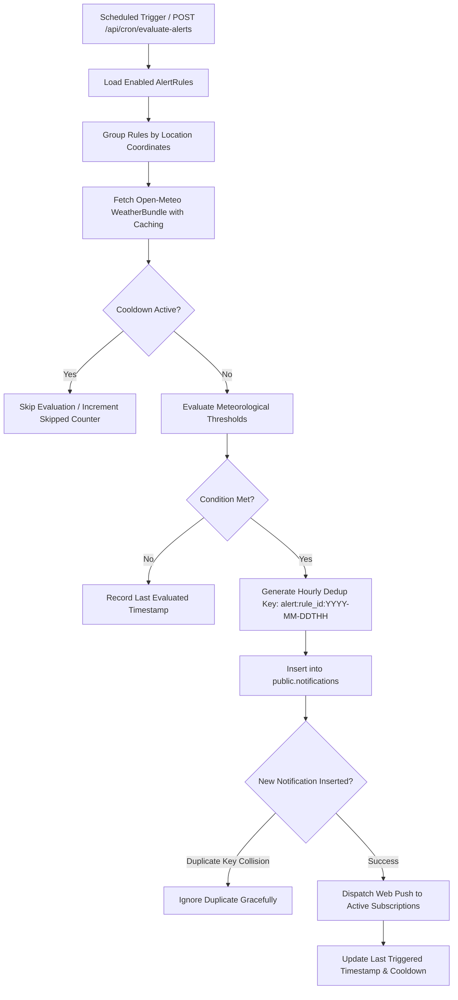

# ATMOS — Weather Alerts, In-App Notifications & Web Push Architecture

## Milestone 7 (M7) Technical Documentation

---

## 1. Executive Summary

ATMOS Milestone 7 delivers a persistent, user-configurable meteorological alerting engine coupled with an in-app notification center and standards-compliant Web Push subscription lifecycle. The system continuously evaluates atmospheric thresholds against authoritative Open-Meteo observations and 24-hour hourly forecasts, applying hourly deduplication and user-configured suppression cooldowns to protect against alert storms.

### Key Architectural Pillars
1. **Configurable Alert Rules**: Users configure meteorological thresholds across six supported event types:
   - High Temperature (`temp_above`)
   - Low Temperature (`temp_below`)
   - High Wind Velocity (`high_wind`)
   - Precipitation Onset & Depth (`precipitation`)
   - Freezing Warning (`freeze`)
   - Severe Convective Weather (`severe_weather`)
2. **Deterministic Evaluation Engine**: Decoupled, testable evaluation logic (`alert-evaluator.ts`) that normalizes canonical units and compares observed telemetry with configured comparison operators (`>`, `>=`, `<`, `<=`, `==`).
3. **Multi-Tenancy & Row-Level Security**: Supabase tables (`alert_rules`, `notifications`, `push_subscriptions`) strictly enforce `auth.uid() = user_id`, revoking direct anonymous table access.
4. **Storm Suppression & Deduplication**:
   - Time-windowed deduplication keys (`alert:rule_id:YYYY-MM-DDTHH`) prevent duplicate alerts within the same hour.
   - User-configurable cooldowns (default 6 hours) suppress repeat triggers while extreme conditions persist.
5. **In-App Notification Center**: Accessible drawer component (`NotificationCenter`) in the main header featuring live unread badge, category iconography, severity levels (`info`, `warning`, `critical`), and instant mark-as-read/clear actions.
6. **Web Push Protocol Integration**: Standards-compliant Web Push with VAPID authentication, graceful permission requesting, and safe simulated preview mode in local development.

---

## 2. Directory Structure

```
src/
├── app/
│   └── api/
│       ├── cron/
│       │   └── evaluate-alerts/
│       │       └── route.ts              # Protected scheduler trigger endpoint
│       └── user/
│           ├── alerts/
│           │   ├── route.ts              # GET / POST alert rules
│           │   └── [id]/
│           │       └── route.ts          # GET / PATCH / DELETE alert rule
│           ├── notifications/
│           │   ├── route.ts              # GET / PATCH (mark all) / DELETE (clear)
│           │   └── [id]/
│           │       └── route.ts          # PATCH (mark read) / DELETE
│           └── push/
│               └── subscribe/
│                   └── route.ts          # POST / DELETE push subscriptions
├── components/
│   └── notifications/
│       ├── alert-rules-manager.tsx       # Alert configuration interface in /account
│       ├── notification-center.tsx       # Main header bell & drawer component
│       └── push-toggle.tsx               # Browser Web Push permission toggle
└── lib/
    └── notifications/
        ├── domain/
        │   └── schemas.ts                # Zod validation schemas & domain models
        ├── evaluator/
        │   ├── alert-evaluator.ts        # Pure evaluation functions & unit conversion
        │   └── evaluation-orchestrator.ts# Weather query deduplication & dispatch
        └── service/
            ├── alert-service.ts          # Alert rule CRUD with Supabase RLS
            ├── notification-service.ts   # In-app inbox persistence & deduplication
            └── push-service.ts           # Web Push dispatch & subscription tracking
```

---

## 3. Meteorological Evaluation & Alert Trigger Rules



### Supported Meteorological Alert Types

| Alert Type | Telemetry Source | Unit Options | Severity | Description |
|---|---|---|---|---|
| `temp_above` | Current temperature | °C, °F | `warning` / `critical` (&ge; 40°C / 104°F) | Heatwave or high temperature thresholds |
| `temp_below` | Current temperature | °C, °F | `warning` / `critical` (&le; -10°C / 14°F) | Cold snap or sub-zero alerts |
| `high_wind` | Current wind speed | km/h, mph, m/s, kn | `warning` / `critical` (&ge; 90 km/h / 55 mph) | Gale-force gusts and structural wind risks |
| `precipitation` | 12h forecast probability or volume | %, mm, inch | `info` / `warning` (&ge; 80% or &ge; 5mm) | Rain/snow onset and accumulation tracking |
| `freeze` | Current & 12h forecast minimum | °C, °F | `critical` (&le; 0°C / 32°F) | Frost and black ice alerts |
| `severe_weather` | Current & 6h forecast WMO codes | WMO code (95, 96, 99, 82) | `critical` | Convective thunderstorms, hail, and squalls |

---

## 4. Database Schema & Multi-Tenancy

Implemented in forward-only migration [`supabase/migrations/20260926020000_m7_notifications.sql`](file:///E:/projects/Atmos/supabase/migrations/20260926020000_m7_notifications.sql):

1. **`alert_rules`**:
   - `id UUID PRIMARY KEY`, `user_id UUID REFERENCES auth.users(id) ON DELETE CASCADE`.
   - `alert_type`, `threshold_value`, `threshold_unit`, `comparison_operator`, `cooldown_minutes`.
   - Geographic coordinates (`latitude NUMERIC(8,5)`, `longitude NUMERIC(8,5)`) and `location_name`.
   - `enabled BOOLEAN`, `last_evaluated_at`, `last_triggered_at`.
   - Index on `(user_id, enabled)` and `(enabled, last_evaluated_at)`.
2. **`notifications`**:
   - `id UUID PRIMARY KEY`, `user_id UUID REFERENCES auth.users(id) ON DELETE CASCADE`.
   - `alert_rule_id UUID REFERENCES alert_rules(id) ON DELETE SET NULL`.
   - `title`, `message`, `category`, `severity`, `read BOOLEAN`, `dedup_key`.
   - Unique index on `(user_id, dedup_key)` preventing duplicate alert storms.
3. **`push_subscriptions`**:
   - `id UUID PRIMARY KEY`, `user_id UUID REFERENCES auth.users(id) ON DELETE CASCADE`.
   - `endpoint TEXT`, `p256dh TEXT`, `auth TEXT`, `user_agent TEXT`, `enabled BOOLEAN`.
   - Unique constraint `(user_id, endpoint)` preventing duplicate subscriptions.

---

## 5. Security & Verification

1. **Zero Secret Leakage**:
   - `VAPID_PRIVATE_KEY` and `CRON_SECRET` remain strictly server-side (`serverEnv`).
   - Only `NEXT_PUBLIC_VAPID_PUBLIC_KEY` is exposed to client Web Push registration.
2. **Scheduled Endpoint Protection**:
   - `POST /api/cron/evaluate-alerts` enforces `Authorization: Bearer <CRON_SECRET>` or `x-cron-secret` in production environments.
3. **Rate Limiting**:
   - Alert creation endpoints are protected by `SlidingWindowRateLimiter` (30 requests/minute per client IP).
4. **Automated Test Coverage**:
   - Evaluator engine unit tests (`tests/unit/alert-evaluator.test.ts`): Cooldown elapsed/active tests, dedup key generation, operator comparisons, unit conversions (°C/°F, kmh/mph/kn), freeze and severe storm detection.
   - Route integration tests (`tests/integration/notification-routes.test.ts`): 401 unauthorized rejection, 400 schema validation, cron authorization, and duplicate suppression.
